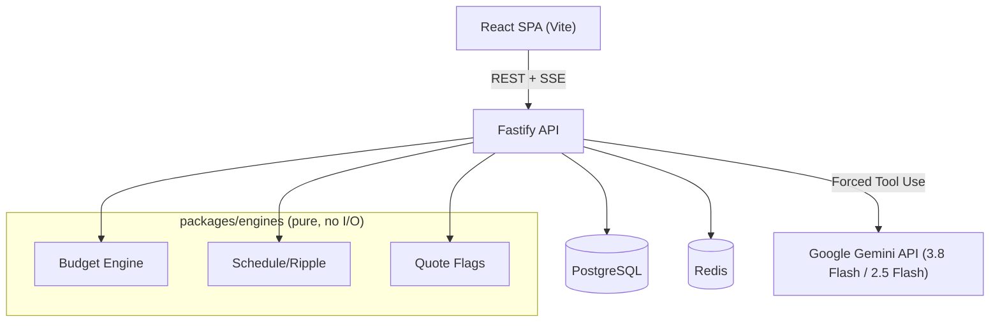

# EventPilot

> GenAI-powered celebration and event planning assistant for weddings, birthdays, and community events.

## 5-Minute Quickstart

### Prerequisites

- Node.js 20+
- pnpm 9+
- PostgreSQL 16+
- Redis 7+

### Option A: Using Docker for databases

```bash
docker compose up -d        # Start Postgres + Redis
```

### Option B: Manual databases

Ensure Postgres and Redis are running, then update `.env` with your connection strings.

### Setup

```bash
cp .env.example .env        # Configure your environment
pnpm install                # Install all dependencies
pnpm seed                   # Load seed data (requires Postgres)
pnpm dev                    # Start API (port 3000) + Web (port 5173)
```

### Quality Checks

```bash
pnpm lint                   # ESLint (strict TS + jsx-a11y)
pnpm typecheck              # TypeScript strict mode
pnpm test                   # All test suites
pnpm test:e2e               # Playwright e2e tests
pnpm build                  # Production build
```

## Architecture



## Environment Variables

See [.env.example](.env.example) for all configurable values.

| Variable                | Required | Default               | Description                  |
| ----------------------- | -------- | --------------------- | ---------------------------- |
| DATABASE_URL            | ✅       | —                     | PostgreSQL connection string |
| REDIS_URL               | ✅       | —                     | Redis connection string      |
| GEMINI_API_KEY          | ✅       | —                     | Google Gemini API key        |
| GEMINI_MODEL            | —        | gemini-3.8-flash      | Primary Gemini model         |
| GEMINI_FALLBACK_MODEL   | —        | gemini-2.5-flash      | First fallback model         |
| GEMINI_FALLBACK_MODEL_2 | —        | gemini-2.5-flash-lite | Second fallback model        |
| LLM_MODE                | —        | live                  | `live` or `fixture`          |
| NOTIFY_MODE             | —        | dry-run               | `dry-run` or `twilio`        |
| PORT                    | —        | 3000                  | API server port              |

## Documentation

- [Architecture](docs/ARCHITECTURE.md) — System design and Mermaid diagrams
- [Security](docs/SECURITY.md) — Threat model and mitigations
- [Testing](docs/TESTING.md) — Test suites and coverage
- [Accessibility](docs/A11Y.md) — WCAG 2.2 AA compliance
- [Scorecard](docs/SCORECARD.md) — Problem statement traceability
- [Demo](docs/DEMO.md) — 3-minute demo script
- [Dependencies](docs/DEPENDENCIES.md) — Justification for each dependency
- [Assumptions](docs/ASSUMPTIONS.md) — Design decisions and defaults
- [ADRs](docs/adr/) — Architectural Decision Records
